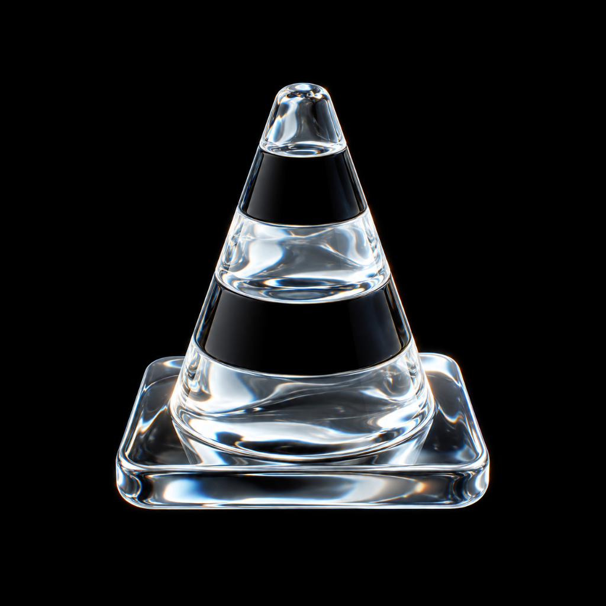
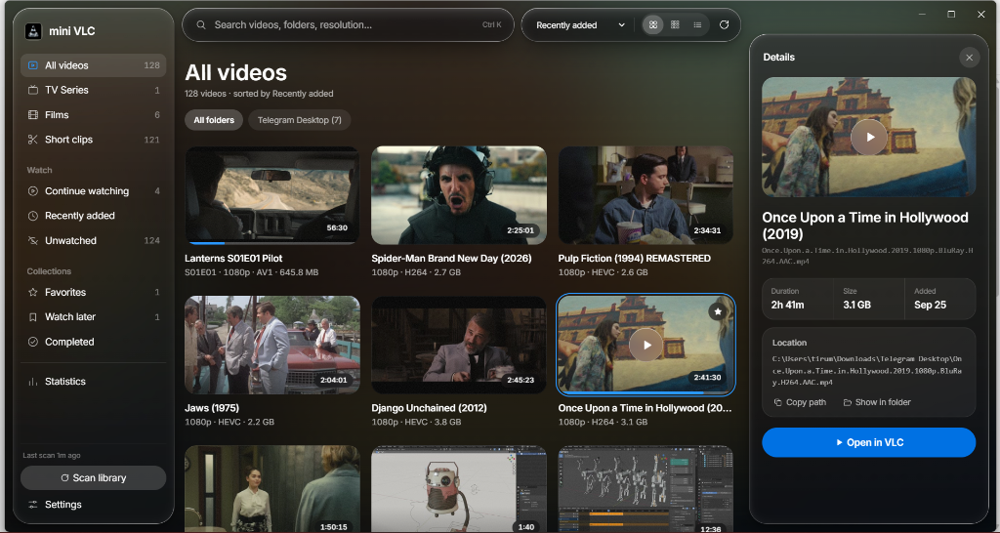
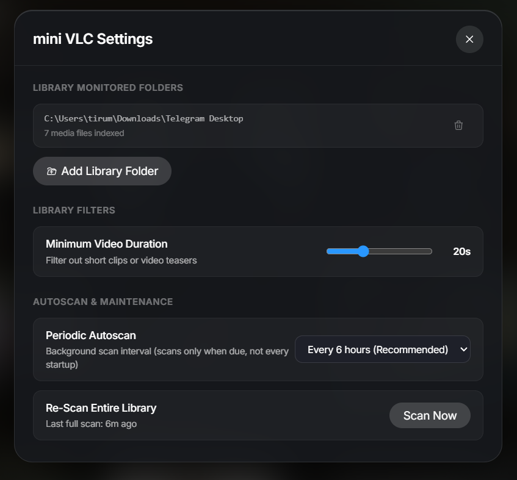
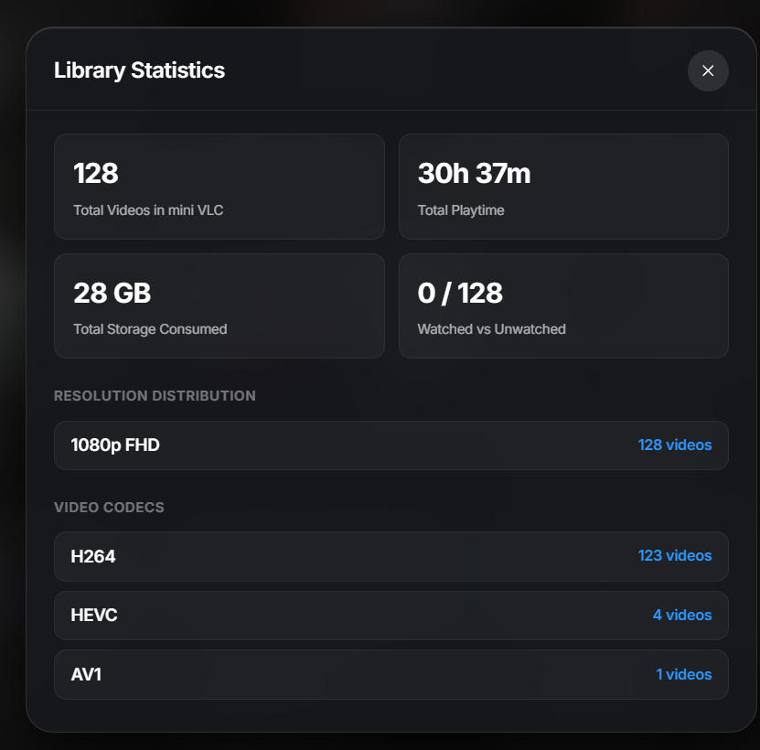

#  mini VLC

> **Local Video Library & Player with Apple Liquid Glass Aesthetics**  
> *A high-performance, dark-mode desktop application built for organizing, browsing, and streaming personal media collections.*

---

## Interface Preview



<p align="center">
  
  
</p>

---

## Features

- **Apple Liquid Glass Design Language**:
  - Genuine optical refraction powered by SVG displacement maps (`backdrop-filter`).
  - Chromatic dispersion with specular highlight rims.
  - Dynamic ambient backdrop: active video art softly radiates behind frosted glass panels.
  - Strict typography hierarchy using SF Pro / Inter font metrics and consistent Apple spatial design tokens.

- **High-Performance Local Library**:
  - Embedded **SQLite3** database (`better-sqlite3`) for fast indexing and instant metadata search across thousands of video files.
  - Automated recursive folder scanner with recursive directory watching.
  - Media metadata extraction (duration, resolution, container, codecs, audio channels, subtitle tracks).
  - Background thumbnail cache generation with dedicated low-latency URI scheme (`mediavault-thumb://`).

- **Dual Playback Engine**:
  - **Embedded Player**: Hardware-accelerated Chromium video renderer with scrub previews, keyboard hotkeys, and full-screen support.
  - **On-The-Fly Audio Transcoding**: Seamless multi-track audio switching via custom streaming protocol (`mediavault-stream://`) powered by FFmpeg.
  - **External Player Integration**: One-click instant launch in external media players (e.g. VLC Media Player) with automatic state persistence.

- **Smart Filename Sanitization**:
  - Intelligent release tag extraction (automatically stripping resolution tags, encoding markers, scene release suffixes like `1080p`, `x264`, `WEBRip` into structured badges).
  - Clean display titles while preserving original file paths for library integrity.

- **Adaptive & Responsive Layout**:
  - Fluid grid layout adapting seamlessly from full-width multi-column grids down to compact icon rails.
  - Detachable / slide-out inspector panel with full codec details, bitrate, aspect ratio, and tags.

---

## Deliverables & Packaging

mini VLC is designed for cross-platform deployment using **Electron** and **electron-builder**.

| Platform | Deliverable Format | Description |
|---|---|---|
| **Windows** | `.exe` (Portable) | Self-contained, single-file executable. Runs instantly without installation. |
| **Windows** | `Setup.exe` (NSIS) | Installer package with desktop shortcut and uninstaller. |
| **macOS** | `.dmg` / `.zip` | Universal / x64 Apple bundle with Native TitleBar Overlay styling. |
| **Linux** | `.AppImage` / `.deb` | Standalone Linux AppImage and Debian package. |

---

## Getting Started

### Prerequisites

- [Node.js](https://nodejs.org/) (v18 or higher recommended, tested on v24+)
- [npm](https://www.npmjs.com/) (v9+)
- *(Optional)* [FFmpeg](https://ffmpeg.org/) on your system `PATH` (used for background thumbnail generation and on-the-fly audio transcoding).

### Installation

1. **Clone the repository**:
   ```bash
   git clone https://github.com/<your-username>/miniVLC.git
   cd miniVLC
   ```

2. **Install dependencies**:
   ```bash
   npm install
   ```

3. **Start the development application**:
   ```bash
   npm start
   ```

---

## Building Deliverables

### Windows Standalone & Installer (.exe)
```bash
# Build Windows Installer (NSIS) & Portable Executable
npm run dist:win
```
The output executables will be generated in the `dist/` directory:
- `dist/mini VLC <version>.exe` (Standalone Portable)
- `dist/mini VLC Setup <version>.exe` (NSIS Installer)

### Cross-Platform Packaging
```bash
# Package for all configured targets (requires target toolchains)
npm run dist
```

---

## Project Structure

```
MediaVault/
├── assets/                 # App icon (.ico, .png) and screenshots
│   ├── icon.ico
│   ├── icon.png
│   ├── mediavault.ico
│   ├── mediavault.png
│   ├── mediavault_app_screenshot.png
│   ├── mediavault_settings_screenshot.png
│   └── mediavault_stats_screenshot.png
├── main/                   # Electron Main Process
│   ├── db/                 # SQLite database initialization & queries
│   │   └── database.js
│   ├── ipc/                # IPC router & handler registrations
│   │   └── router.js
│   └── services/           # Background services (scanner, system, VLC)
│       ├── scanner.js
│       ├── system.js
│       └── vlc.js
├── src/                    # Electron Renderer Process (UI)
│   ├── assets/             # Fonts and bundled web assets
│   ├── styles/             # Modular CSS stylesheets & design tokens
│   │   ├── base.css
│   │   ├── glass.css       # Liquid Glass refraction & blur effects
│   │   ├── mediavault.css  # Application layout & components
│   │   └── tokens.css      # Apple Design Tokens
│   ├── app.js              # Frontend application logic
│   ├── glass.js            # Dynamic SVG refraction engine
│   └── index.html          # Main application window markup
├── main.js                 # Electron application entry point
├── preload.js              # Secure context-isolation bridge
├── package.json            # Project manifest and electron-builder config
├── .gitignore              # Git ignore rules for node_modules and builds
└── README.md               # Project documentation
```

---

## License

This project is licensed under the MIT License — see the [LICENSE](LICENSE) file for details.
